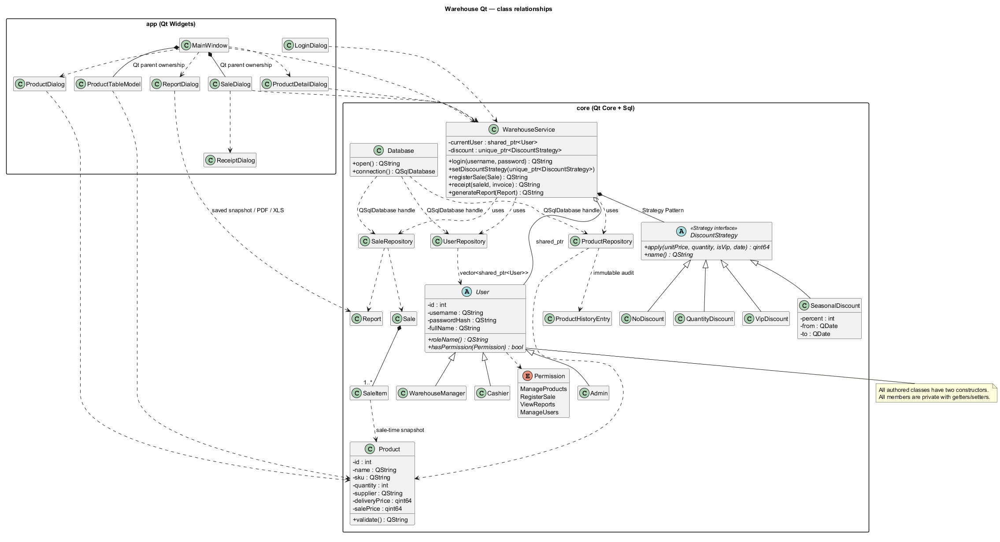

# Architecture

## Targets and boundaries

| Target | Dependencies | Responsibility |
|---|---|---|
| warehouse_core | Qt6::Core, Qt6::Sql | Data, roles, pricing, persistence, permissions, transactions, HTML |
| warehouse_app | warehouse_core, Qt6::Widgets | Bulgarian forms and tables, integer-price input/display, PDF export |
| warehouse_tests / tst_inventory / tst_discounts / tst_permissions | warehouse_core, Qt6::Test | Core verification without Widgets |
| tst_gui | warehouse_core, Qt6::Widgets, Qt6::Test | Login, product input, checkout, PDF, reports and users |

GUI code calls WarehouseService; it does not execute SQL.
The core does not include Widgets. QPdfWriter needs no extra PrintSupport dependency.
Widgets are constructed in C++ without .ui files.
User-facing strings use tr(); Q_DECLARE_TR_FUNCTIONS supplies it to core classes without QObject inheritance.

## Classes and ownership

Product, Sale, SaleItem and Report are plain data classes with private fields and public accessors.
Each authored class has two constructors, including abstract bases and test classes.
User defines pure virtual roleName() and hasPermission(). Admin, WarehouseManager and Cashier
implement the permission table with switches.

UserRepository returns std::vector<std::shared_ptr<User>>.
WarehouseService holds a shared_ptr<User> session and a unique_ptr<DiscountStrategy>.
Virtual destructors allow safe destruction through either base class.
The service and Database are stack objects in main; Database is constructed first and destroyed last.
Widgets use Qt parent ownership exclusively. Their service pointer is a non-owning observer.
Database cannot be copied because it owns a named Qt SQL connection.
Its path/name setters only work before registration; the session setter authenticates credentials.

## Strategy Pattern and money

DiscountStrategy is the abstract Strategy interface. WarehouseService is its context.
SaleDialog's combo box installs NoDiscount, QuantityDiscount, VipDiscount or SeasonalDiscount at runtime.

apply() returns the **line total**, not the unit price.
Quantity thresholds are per cart product: 9 units have no discount; 10–49 receive 5%; 50+ receive 10%.
VIP gives 10% only for VIP customers. Seasonal dates are inclusive and use the current local date.
Only one selected strategy applies; discounts do not stack.
A seasonal percentage is clamped to 0–100. Reversed seasonal dates disable checkout.

Prices are qint64 euro cents. Discount arithmetic rounds the final line to the nearest cent,
with a half-cent rounded up: 3 × €1.23 with VIP becomes €3.32.
ProductDialog parses decimal text directly into integer cents, accepting comma or period.
The GUI formats money with formatCents(); receipt HTML has its own core formatting.
The service rejects quantity/price/cost totals that would overflow qint64.

## SQLite schema and transactions

Database::open creates these tables and seeds newly created users/products tables.

| Table | Columns |
|---|---|
| users | id PK, username UNIQUE, password_hash, full_name, role |
| products | id PK, name, sku UNIQUE, quantity, supplier, delivery_price, sale_price |
| sales | id PK, created_at, user_id FK, customer_name, is_vip, discount_name, total |
| sale_items | id PK, sale_id FK, product_id FK, quantity, unit_price, line_total, delivery_price, product_name, product_sku |
| reports | id PK, created_at, date_from, date_to, revenue, profit, units_sold |

The three extra sale_items columns were approved by the user. They preserve the delivery cost,
name and SKU at sale time so later product edits cannot change historical profit or receipts.
unit_price stores the original sale price; line_total stores the discounted result.
Foreign keys prevent deleting products/users referenced by sales.
Prepared statements bind user-entered values; role identifiers are admin, manager and cashier.

registerSale first checks permission, begins a transaction, reloads stock/prices and validates all lines.
It conditionally decreases stock, saves the sale and all items, then commits.
Any error rolls back stock and rows; the caller's sale ID changes only after commit.
A second submission of an already saved sale is rejected.
A blank customer becomes “Клиент на дребно”.

Reports include both endpoint dates. Revenue is SUM(line_total);
profit is SUM(line_total − quantity × sale-time delivery_price); units sold is SUM(quantity).
Each generated report is saved; empty periods return zero totals.
receipt() escapes customer and product text and produces receipt or invoice HTML.
ReceiptDialog renders it in QTextBrowser and saves a PDF through QPdfWriter.

## Permissions and GUI

| Operation | Admin | WarehouseManager | Cashier |
|---|---|---|---|
| ManageProducts | yes | yes | no |
| RegisterSale | yes | no | yes |
| ViewReports | yes | yes | no |
| ManageUsers | yes | no | no |

All logged-in users may read the product catalog. Protected operations check permission in the service.
GUI buttons/tabs reflect permissions; disabling a button is not the authorization mechanism.
An admin cannot delete or demote their own active account.
LoginDialog opens MainWindow. Its tabs are Products, Sales and Reports; admins also get Users.
ProductTableModel feeds QTableView. SaleDialog is embedded in the Sales tab.
Switching to Products or Sales reloads stock. See [User guide](USER_GUIDE.md).

## UML and requirement evidence



[PlantUML source](../uml/class-diagram.puml) shows the User and Strategy hierarchies,
repository dependencies, smart-pointer ownership and the core/app package boundary.
Open triangles mean inheritance; filled diamonds show composition; dashed arrows show use.
The Strategy interface is a pure abstract C++ class, not an extra interface hierarchy.
The diagram omits repetitive getters/setters for readability.

The PNG was generated locally using PlantUML 1.2026.9beta4 and Java 8.
The source uses Smetana, so no separate Graphviz setup is needed.
To render from the repository directory, obtain the Java 8 jar from the
[official PlantUML download page](https://plantuml.com/en/download), then run:

```powershell
java -jar build-verified/plantuml.jar -tpng docs/uml/class-diagram.puml
```

[Compliance audit](COMPLIANCE.md) maps every hard requirement to its source files.
